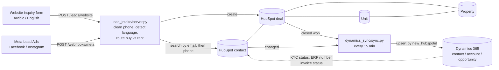
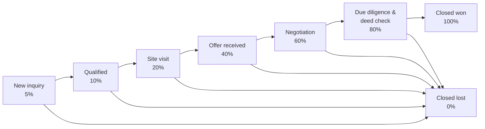
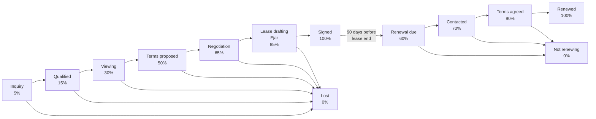

# Architecture

## Data flow

The dotted line is the reverse direction. Those fields are owned by Dynamics (see
`dynamics_sync/field_mapping.json`); this repo only implements HubSpot to Dynamics, and the
reverse can be a Power Automate flow or a second job with the same mapping file.

## Objects

| Object | What one record is | Key fields |
|---|---|---|
| Contact | A buyer, tenant or broker | type (individual / company), budget range, preferred asset type and city, first-touch lead source, preferred language |
| Company | A corporate buyer or tenant | CR number, VAT number |
| Property (custom) | A land plot or an income asset | listing ID (unique), asset type, city, district, plot area, zoning, deed number, asking price, status |
| Unit (custom) | A leasable unit inside an income asset | unit no., floor, area, asking annual rent, status, lease end date, Ejar contract no. |
| Deal | One sale, lease or renewal | pipeline-specific fields below |

Association labels: Deal to Property (*Listing for sale*, *Leased asset*), Deal to Unit
(*Leased unit*), Unit to Property (*Unit in building*), Contact to Deal (*Buyer*, *Tenant*,
*Broker*, *Guarantor*), Contact to Unit (*Current tenant*).

## Land Sales pipeline

| Stage | Enters when | Leaves when | Required to enter |
|---|---|---|---|
| New inquiry | Any buy / land inquiry (website, ads, phone, walk-in) | First call done, budget and purpose known | |
| Qualified | Budget and purpose confirmed, budget fits an available plot | Site visit booked | confirmed budget, purpose, asset type |
| Site visit | Visit date set, plot linked to the deal | Buyer makes an offer | site visit date |
| Offer received | Offer and payment method recorded | Counter-offer sent or accepted in principle | offered price, payment schedule |
| Negotiation | Price or terms in discussion | Price agreed | offered price |
| Due diligence & deed check | Agreed price recorded, deed and zoning verified | Contract signed or blocking issue | agreed price, deed check status |
| Closed won (contract signed) | Contract signed, deposit received | Final; property set to Sold | agreed price, amount, close date |
| Closed lost | Buyer withdrew or deal blocked | Final | lost reason |

## Leasing and Renewals pipelines

| Stage | Enters when | Leaves when | Required to enter |
|---|---|---|---|
| Inquiry | Any rent inquiry for an office, shop or apartment | Needs known (type, size, budget, move-in) | |
| Qualified | Needs fit at least one vacant unit | Viewing booked | asset type, confirmed budget |
| Viewing | Viewing date set, unit linked | Tenant wants the unit | viewing date |
| Terms proposed | Rent, term and payment schedule sent | Accepted or countered | annual rent, lease term, payment schedule |
| Negotiation | Rent, free period or fit-out in discussion | Terms agreed | annual rent |
| Lease drafting (Ejar) | Contract being registered on Ejar | Both sides approved | annual rent, lease start, lease term |
| Signed | Ejar contract number recorded | Final; unit set to Leased | Ejar no., lease start and end, amount, close date |
| Lost | Tenant withdrew | Final | lost reason |
| Renewal due | Created 90 days before the unit's lease end | Tenant contacted | lease end date |
| Contacted | Renewal offer discussed | Agreed or tenant says no | |
| Terms agreed | New rent and term agreed | Registered on Ejar | renewal rent, lease term |
| Renewed | New Ejar contract recorded | Final; unit lease end updated | Ejar no., lease end, amount, close date |
| Not renewing | Tenant leaves | Final; unit back to Vacant on lease end | lost reason |

Required properties per stage are set in **Settings > Objects > Deals > Pipelines > Edit stage
properties**. `setup_hubspot.py` prints the full list as a checklist.

## Workflows to add in HubSpot

These are built in the workflow editor (Operations Hub or Sales Hub Professional):

1. **Renewal due** (Unit-based): when *Lease end date* is 90 days away and status is Leased,
   create a deal in Renewals / Renewal due, associate the unit, property and current tenant,
   copy the lease end date, assign the property manager.
2. **Signed lease updates the unit**: when a Leasing deal moves to Signed, set the associated
   unit to Leased and copy lease end date and Ejar number to it.
3. **Sale closes the plot**: when a Land Sales deal moves to Closed won, set the property to Sold.
   Moving to Offer received sets it to Reserved.
4. **Speed to lead**: new deal in New inquiry / Inquiry, task for the owner due in 1 hour, and a
   WhatsApp or email reply template in the contact's preferred language.

## Reports and dashboards

| Report | Type | Built from |
|---|---|---|
| Pipeline value by asset type | Stacked bar, open deals | Deals: amount (weighted), group by *asset type*, split by pipeline |
| Vacancy by property | Table / bar | Units: count, group by associated property, split by *status*; vacancy % = vacant / total |
| Renewals due in 90 days | List | Units with lease end date in the next 90 days, with tenant and current rent; plus Renewals pipeline board |
| Lead source to closed won | Funnel / table | Deals: count and amount by *lead source*, created vs closed won, conversion % |
| Lost reasons | Pie | Closed lost / Lost / Not renewing deals by *lost reason*, per pipeline |
| Speed to first contact | Bar | Time from deal create to first logged call or email, by owner |

Suggested dashboards: **Sales** (pipeline value, offers this month, lead source funnel),
**Leasing** (vacancy, viewings this week, renewals due), **Management** (closed won SAR by
month, occupancy trend, lost reasons).
